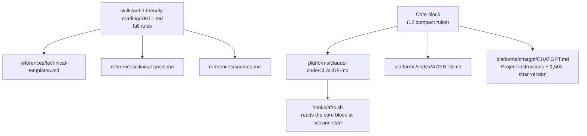

# Compatibility, testing and limitations

**Summary:** AFRS is Markdown only. It uses each platform's native instruction
mechanism: an always-on instruction file (`CLAUDE.md`, `AGENTS.md`, ChatGPT
Custom/Project instructions) guarantees that the format applies automatically,
and an Agent Skill (`SKILL.md`) adds the full rules and templates on demand. No
code is required. An optional Claude Code plugin (and an optional Codex hooks
file) adds two hooks backed by a small POSIX shell script: one loads the rules at
session start, one adds a one-line reminder each turn so the format doesn't fade
in long sessions.

**This covers:** 1) how each platform loads instructions 2) the architecture
3) how it was tested 4) known limitations

Last verified against public documentation: November 2026.

---

## 1/4 — How each platform loads instructions

| | Claude Code | OpenAI Codex | ChatGPT |
| --- | --- | --- | --- |
| Always-on file | `CLAUDE.md` (`~/.claude/CLAUDE.md` global, or in the project) | `AGENTS.md` (`~/.codex/AGENTS.md` global, or in the repo and subfolders) | Custom Instructions (global) or Project instructions |
| Skill location | `~/.claude/skills/<name>/SKILL.md` or `.claude/skills/` | `~/.agents/skills/<name>/SKILL.md` or `.agents/skills/` | Upload in the Skills area (where the plan has Skills) |
| Skill format | Agent Skills: YAML front matter (`name`, `description`) + Markdown | Same open format; optional `agents/openai.yaml` for UI metadata | Same open format |
| How a skill loads | Name and description are always visible; the body loads when the task matches or on `/adhd-friendly-reading` | Same progressive loading; explicit call with `$adhd-friendly-reading` | Loads when ChatGPT judges it relevant, or when named |
| Mermaid | Shown as source in the terminal (AFRS prefers text walkthroughs there) | Shown as source in the CLI (same) | Depends on app and version |
| Optional hooks | Plugin: `hooks/hooks.json` (SessionStart + UserPromptSubmit) | Personal `~/.codex/hooks.json`; must be trusted via `/hooks` | Not available |
| One-command install | `/plugin marketplace add` + `/plugin install` | Manual copy | Paste or upload |
| Colored text | Not possible | Not possible | Not possible |

**Key consequence:** skills load *when the model decides the task matches*. A
reading format is cross-cutting (it applies to any long answer), so relying on
the skill alone would make activation unreliable. That is why AFRS always ships
a compact, always-on block as well.

---

## 2/4 — Architecture

In words:

- **One skill, shared by all three platforms.** The same `SKILL.md` folder works
  in Claude Code, Codex and ChatGPT because all three use the open Agent Skills
  format.
- **One core block, copied into each platform file.** The 12 rules are word for
  word the same in `CLAUDE.md`, `AGENTS.md` and the ChatGPT project
  instructions. Only the short "specifics" section differs per platform.
- **A shorter version for ChatGPT Custom Instructions**, because those fields have
  a character limit.

**If you edit the rules:** change the core block in all three platform files,
the short Custom instructions version in `CHATGPT.md`, the corresponding rule in
`SKILL.md`, the switch tables in both READMEs, and the one-line reminder in
`hooks/afrs.sh` (the session hook reads the core block from
`platforms/claude-code/CLAUDE.md`, so it updates by itself).

---

## 3/4 — How it was tested

### Static checks (run on every file in this repository)

| Check | Result |
| --- | --- |
| `SKILL.md` front matter is valid YAML with `name` and `description` | Pass |
| `name` uses lowercase letters and hyphens and matches the folder name | Pass |
| Core block identical in `CLAUDE.md`, `AGENTS.md` and `CHATGPT.md` | Pass |
| ChatGPT Custom instructions blocks fit the 1,500-character Free/Go limit, even combined | Pass (≈220 + ≈1,220 = ≈1,450) |
| Every Mermaid diagram in the repository renders without errors | Pass (Mermaid CLI 11.16.0, 21 Nov 2026) |
| Markdown lint (structure, headings, code fences) | Pass (markdownlint-cli2 0.23.2, 21 Nov 2026; see `.markdownlint.json` for the rules disabled) |
| Claude Code plugin and marketplace manifests | Pass (`claude plugin validate`, Claude Code 2.1.330, 21 Nov 2026) |
| Hook script: rules printed at session start, skipped when `CLAUDE.md`/`AGENTS.md` already has them, one-line reminder per turn, silent when turned off | Pass (sandbox tests with `sh` and `dash`, 21 Nov 2026) |
| Hooks running inside a live Claude Code or Codex session | Not yet tested (no authenticated session available when built); use the manual test below |
| Examples: every fact in each "Before" is present in the matching "After" | Checked by hand and by an independent review |
| Citations: authors, journals, volumes and DOIs | Spot-checked against publisher and PubMed pages by an independent review |

### Manual behavior test (do this after installing)

Run these prompts on each platform, with AFRS installed, and check the list.

1. **Long technical answer:** "Explain how OAuth 2.0 authorization code flow
   with PKCE works, step by step."
2. **Document type:** "Write an ADR for adopting PostgreSQL read replicas."
3. **Short answer (must stay normal):** "What does `git stash pop` do?"
4. **Switch off:** "No summaries from now on." Then repeat prompt 1.
5. **Language:** ask prompt 1 in Portuguese.
6. **Hooks (plugin only):** start a new session and ask "Did you receive AFRS
   instructions at session start and with this message?" It should mention
   both. Then run `/afrs:toggle off`, start a new session and ask again.

Checklist for prompts 1, 2 and 5:

- [ ] Opens with a 1–3 sentence summary.
- [ ] Short paragraphs, one idea each; headings state conclusions.
- [ ] Cause and effect are written out.
- [ ] Code, commands and identifiers unchanged, in `code` formatting.
- [ ] Diagram (if any) is followed by a text explanation.
- [ ] No HTML color tags, no decorative emoji.
- [ ] Not noticeably shorter or less detailed than without AFRS.

Expected for prompt 3: a normal, short answer. Expected for prompt 4: no
summary line, everything else unchanged.

---

## 4/4 — Known limitations

- **Instructions are guidance, not guarantees.** Language models follow them
  most of the time, not every time. Long conversations can dilute instructions;
  restating "use AFRS" brings the format back.
- **No color rendering.** AI chat interfaces do not render colored text from
  Markdown. AFRS intentionally provides no color gradient. Readers who want one
  can use a separate reading tool on top of any interface.
- **Mermaid is not drawn everywhere.** Terminals show the diagram source. AFRS
  always explains diagrams in text so nothing depends on rendering.
- **Interface layout is out of reach.** Line length, line spacing and fonts
  (WCAG 1.4.8) are set by the app, not by the text.
- **ChatGPT Skills availability varies by plan.** Custom Instructions and
  Projects are the reliable path for most users.
- **Hooks are code.** The optional hooks run `hooks/afrs.sh`, a short POSIX shell
  script with no other dependencies. Read it before installing; Codex makes you
  review and trust hooks before they run.
- **Hook rough edges reported by users.** In the Claude Code VS Code extension, a
  `UserPromptSubmit` hook's context was reported not to reach the model; in the
  Codex desktop app, `SessionStart` hooks were reported not to run. The always-on
  `CLAUDE.md`/`AGENTS.md` route does not depend on hooks, so keep it if you hit
  either issue.
- **Windows and hooks.** Claude Code runs the plugin hooks with `sh` (available
  through Git Bash). The Codex hooks file in this repository uses `sh` too, so
  on Windows use it from WSL or Git Bash.
- **Token cost of the reminder.** About 50 tokens per message. Turn it off with
  `/afrs:toggle off` (Claude Code) or `sh ~/.afrs/afrs.sh off` (Codex).
- **Other formatting instructions can pull in another direction.** Skills that
  aim for short answers, such as `i-have-adhd` (one of AFRS's inspirations), serve
  a different goal. Using both at once can give mixed signals, so pick the one
  that fits the task, or tell the assistant which to follow.
- **Evidence limits.** See [RESEARCH.md](RESEARCH.md). The rules are informed by
  research on ADHD and reading, but AFRS itself has not been tested in a
  controlled study. No clinical effect is claimed.
