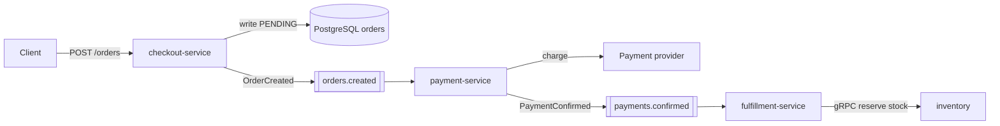

# Example 1 — Architecture explanation

**Prompt:** "Explain how the order processing in our system works and why orders sometimes appear twice."

Both versions below contain the same facts. Only the presentation differs.

---

## Before (conventional answer)

The order flow starts when the `checkout-service` receives a `POST /orders` request and writes the order to the `orders` table in PostgreSQL with status `PENDING`, after which it publishes an `OrderCreated` event to the `orders.created` Kafka topic. The `payment-service` consumes that topic, calls the payment provider, and on success publishes `PaymentConfirmed` to `payments.confirmed`; the `fulfillment-service` consumes `payments.confirmed`, reserves stock in the `inventory` service through a synchronous gRPC call, and creates a shipment. The duplicate orders you are seeing come from the fact that the database write and the Kafka publish in `checkout-service` are not atomic: if the service crashes or the Kafka producer times out after the row is committed but before the broker acknowledges the message, the client receives a `504` and retries, and because the `POST /orders` endpoint has no idempotency key, the retry creates a second row and a second event. Kafka itself can also deliver a message more than once, since consumers use at-least-once semantics with `enable.auto.commit=false` and commit offsets only after processing, so a `payment-service` restart between processing and commit will reprocess the event, but this produces duplicate payment attempts rather than duplicate orders, and the provider rejects those because the service passes the order ID as the provider's idempotency key. The fix is twofold: add an `Idempotency-Key` header to `POST /orders` and store it with a unique constraint, and replace the direct publish with the transactional outbox pattern, where the event is written to an `outbox` table in the same transaction as the order and a relay process (for example Debezium) publishes it to Kafka, which guarantees that an order row and its event are either both created or neither is.

---

## After (AFRS format)

**Summary:** Orders appear twice because `checkout-service` saves the order and publishes its event in two separate steps, and `POST /orders` has no idempotency key: a timeout between the steps makes the client retry and create a second order. The fix is an `Idempotency-Key` header plus the **transactional outbox** pattern, which makes "save order" and "publish event" succeed or fail together.

**This covers:** 1) the normal flow 2) where duplicates come from 3) a duplicate that is *not* the cause 4) the fix

### 1/4 — How an order moves through the system

1. `checkout-service` receives `POST /orders` and writes the order to the `orders` table in PostgreSQL with status `PENDING`.
2. It then publishes an `OrderCreated` event to the Kafka topic `orders.created`.
3. `payment-service` consumes that topic, calls the payment provider and, on success, publishes `PaymentConfirmed` to `payments.confirmed`.
4. `fulfillment-service` consumes `payments.confirmed`, reserves stock in `inventory` through a synchronous gRPC call, and creates a shipment.

### 2/4 — Why orders get duplicated

The root problem is that two steps in `checkout-service` are **not atomic**: writing the row and publishing the event happen separately.

So this sequence is possible: the row is committed, then the service crashes or the Kafka producer times out before the broker acknowledges the message. The client receives a `504` and retries.

Because `POST /orders` has **no idempotency key**, the server cannot recognize the retry as the same request. As a result, the retry creates a second row and a second event.

### 3/4 — A duplicate that looks related but is not the cause

Kafka can also deliver messages twice, but this explains duplicate *payment attempts*, not duplicate orders. Consumers use at-least-once delivery: `enable.auto.commit=false`, and offsets are committed only after processing. If `payment-service` restarts between processing and committing, it processes the same event again.

That produces a second payment attempt. The provider rejects it, because `payment-service` passes the order ID as the provider's idempotency key. So no double charge happens, and this path does not create orders.

### 4/4 — The fix

Two changes, each closing one gap:

| Change | What it does | Gap it closes |
| --- | --- | --- |
| `Idempotency-Key` header on `POST /orders`, stored with a unique constraint | A retried request maps to the existing order instead of creating a new one | Client retries |
| Transactional outbox | The event is written to an `outbox` table in the same transaction as the order; a relay (e.g. Debezium) publishes it to Kafka | Row and event can no longer diverge: both are created, or neither is |

---

## What changed, and why

| Change | Reason |
| --- | --- |
| Summary first, with the cause and the fix | The main point is available before working memory fills up |
| One idea per paragraph | Less to hold in mind at once |
| Diagram + numbered walkthrough | Flow is easier to see; the text version keeps it accessible in terminals and screen readers |
| Numbered sections (`2/4`) | A reader who drifts can see where they are and re-enter |
| Kafka redelivery separated and labeled "not the cause" | In the original it was mixed in, inviting the wrong conclusion |
| Table for the fix | Two parallel changes compared on the same attributes |
| All identifiers unchanged, in `code` | Technical precision preserved |

Nothing was removed: every fact from the "Before" version is in the "After" version.

What was deliberately **not** added: no recap (no section reaches ~250 words), no key takeaways (the answer is under ~800 words), and no "Next:" line (the headings already mark each change of topic). Scaffolding is limited to the summary, the map and the numbered headings.
